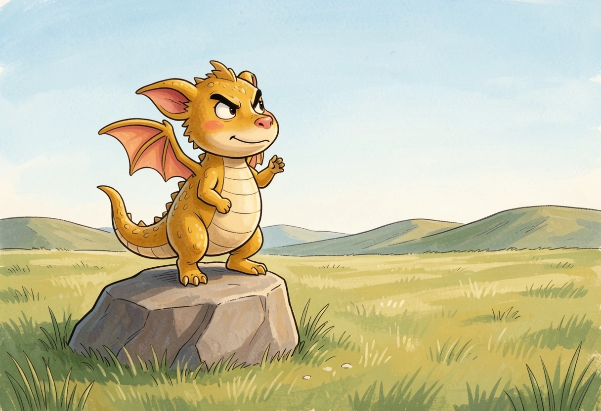
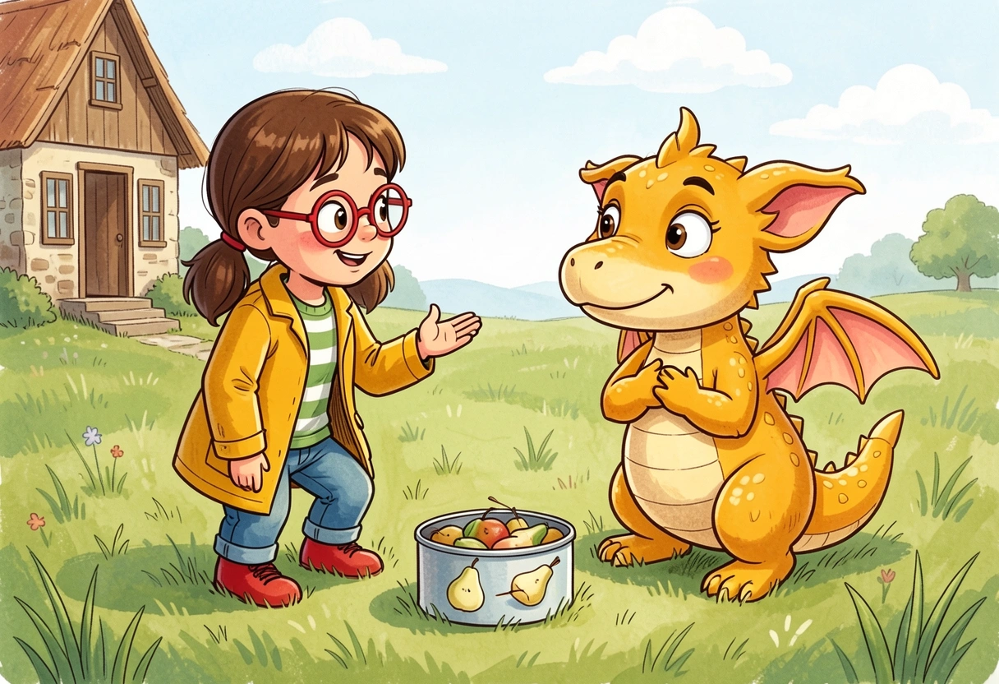
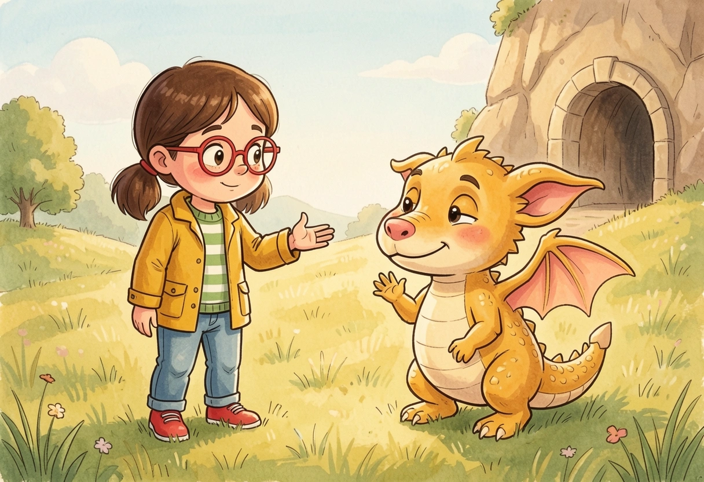

# Drei Schläge für den Bodenweg

> Fiktive Testavatare Nora und Ben. Text geprüft. Drei von vier Illustrationen haben die Bildprüfung bestanden; das nicht bestandene Bild wird nicht gezeigt.

Funkelflug plant einen Auftritt, bei dem endlich alle einen richtigen Drachen sehen sollen. Doch dann läutet die verlassene Wegewarte, und ausgerechnet ein winziger Felsgang wird wichtig.

## Der große kurze Flug

Funkelflug wollte als richtiger Drache ernst genommen werden. Deshalb stand er auf einem kniehohen Felsen und übte, möglichst gewaltig auf eine leere Wiese hinunterzusehen.

Er hob seine winzigen Flügel.

„Verehrtes Publikum! Gleich erlebt ihr einen Flug, wie ihn dieser Berg noch nie—“

Ein Windstoß drückte ihm beide Flügel über den Kopf.

Funkelflug faltete sie sorgfältig zurück.

„Die Spannung steigt.“

Neben der Wiese stand die alte Wegewarte. Ihre Fensterläden hingen schief. Über dem Dach baumelte eine Glocke, die seit Jahren schwieg. Funkelflug wohnte erst seit kurzem in der kleinen Höhle daneben. Die riesigen Landeplatten weiter oben gehörten den großen Drachen. Diesen kleinen Felsen hatte er selbst ausgewählt.

Er war übersichtlich. Besonders von unten.

Unterhalb der Wegewarte wanderte eine Familie bergauf. Nora trug eine Dose mit Birnenspalten, Ben eine zusammengerollte Picknickdecke. Ihr Vater Tom hatte Wasser und belegte Brote im Rucksack.

Sie wollten auf der Höhlenwiese picknicken und dabei einen Wegplan zeichnen. Ben hatte darauf bestanden, dass auch die kleinen Wege darauf Platz bekamen.

Am letzten Abzweig lag allerdings der Wegweiser im Gras.

„Der Pfeil zeigt auf einen Regenwurm“, stellte Ben fest.

Nora drehte ihre Karte. „Die Wiese muss oberhalb sein.“

Da dröhnte hinter einem Felsen eine Stimme:

„Jetzt! Der berühmte Funkelflug erhebt sich!“

„Vielleicht weiß der Berühmte den Weg“, sagte Tom.

Sie folgten dem breiten Pfad um den Felsen.

Funkelflug sprang.

Für einen Augenblick sah es prächtig aus. Kopf hoch, Beine lang, Flügel ausgestreckt.

Dann landete er mit allen vier Füßen in einem Grasbüschel.

Pff.

Ben drückte die Decke an sich. Nora blieb mit offenem Mund stehen.

Funkelflug zog einen Halm aus seinem Nasenloch.

„Das war eine Zwischenlandung.“

Tom betrachtete den Felsen. Dann den Drachen. „Eine ziemlich genaue.“

„Genauigkeit wird unterschätzt“, sagte Funkelflug.

Nora stellte die Dose ab. „Ich bin Nora. Das ist mein Bruder Ben. Und das ist unser Papa Tom.“

„Funkelflug“, sagte der Drache. „Flugvorführungen und besondere Auftritte.“

„Wir haben noch nie einen Drachen aus der Nähe gesehen“, sagte Ben.

Funkelflug richtete sich auf. Endlich!

„Dann seid ihr gerade rechtzeitig. Mein nächster Auftritt beginnt, sobald ausreichend Zuschauer eingetroffen sind.“

Er verbeugte sich. Zwischen seinen Hörnern steckte noch immer das Grasbüschel. Ein Käfer kletterte heraus, betrachtete ihn und krabbelte weiter.

„Einer geht schon“, sagte Ben.

Da schlug die Glocke.

DONG.

Alle sahen zur Wegewarte.

DONG.

Unter dem Dach zuckte eine dünne Schnur zurück in einen dunklen Spalt.

DONG.

Vom unteren Weg kamen Rufe. Eine kleine Wandergruppe bog am umgefallenen Wegweiser ab.

„Drei Schläge!“, rief jemand. „Der Bodenweg ist wieder offen!“

Funkelflug strahlte. „Mein Publikum!“

Dann verstummte er.

Aus dem alten Durchgang unterhalb der Warte drang ein dumpfes Poltern.

„Hier geht es nicht weiter!“

Funkelflug blickte zu seinem Auftrittsfelsen. Dann zu dem niedrigen Eingang.

„Das“, sagte er, „war nicht Teil der Ankündigung.“

## Der Weg wird kleiner

Der alte Bodenweg führte unter einer Felsrippe hindurch. Auf der einen Seite lag der untere Wanderpfad, auf der anderen begann die Höhlenwiese. Dazwischen steckte ein breites Holzbrett schräg im niedrigen Durchgang.

Dahinter standen die Wanderer.

Nora kniete am Wieseneingang nieder. Durch einen dreieckigen Spalt konnte sie Schuhe sehen.

„Nicht weiterdrücken!“, rief sie. „Wir schauen erst.“

Funkelflug tastete die Felswand ab. Unter seinen Krallen rieselte trockener Sand.

„Hier war früher eine Klappe“, sagte er. „Damit im Winter nicht alles hineinweht.“

An einem Ende des Brettes hing eine dicke Zugschnur. Nora entdeckte sie sofort.

„Wenn wir daran ziehen, kommt das Brett bestimmt heraus.“

„Warte“, sagte Ben.

Nora hatte schon gezogen.

Das Brett rutschte eine Handbreit vor. Dann blieb sein unteres Ende an einer Steinkante hängen. Die obere Hälfte kippte hoch und klemmte sich unter die Decke.

Jetzt sperrte es den Durchgang wie eine riesige hochgeklappte Tischplatte.

Funkelflug legte den Kopf schief.

„Sehr gut. Falls jemand im Stehen picknicken möchte.“

Nora ließ die Schnur los. Ihre Ohren wurden rot.

„Ich wollte es aufmachen.“

„Ich weiß“, sagte Ben. „Unten hängt es fest. Das wollte ich sagen.“

Nora rückte zur Seite. „Dann sag jetzt.“

Ben legte sich auf den Bauch. „Hinter dem Brett ist ein Holzstift. Der steckt quer. Wenn man weiterzieht, wird alles schiefer.“

Tom prüfte das Brett mit einer Hand. „Das bewegt keiner mehr, bevor wir den Stift lösen.“

Funkelflug spürte einen kühlen Hauch am rechten Hinterfuß. Neben der Wand klaffte ein schmaler Felsschlitz. Darin roch es nach feuchtem Stein.

Er kannte diesen Luftzug. Gestern hatte er auf der anderen Seite einen winzigen Ausgang entdeckt.

„Da komme ich hinter das Brett.“

Vom unteren Weg rief jemand: „War hier nicht auch eine Drachenvorführung angekündigt?“

Funkelflug hob sofort den Kopf.

Sein Felsen lag im Sonnenlicht. Die Wanderer würden ihn sehen. Endlich mehr Zuschauer als ein Käfer.

„Ihr könntet außen herum zur Wiese kommen“, begann er. „Dann mache ich zuerst—“

„Sind die Leute schon alle vor dem Durchgang?“, fragte Ben.

Funkelflug sah durch den Spalt. Hinter den vorderen Wanderern verschwand der Pfad um eine enge Ecke. Wer dort noch nachkam, konnte das Hindernis nicht sehen.

Er klappte die Flügel ein.

„Die Vorführung fällt aus.“

Das sagte er leiser als seine Flugankündigung.

Dann wurde seine Stimme fest. „Ich brauche Platz hinter dem Brett. Und einen freien Ausgang.“

Nora stand auf. „Ich prüfe den Weg bis zur Wiese.“

„Ich sehe durch das kleine Wandfenster die Kurve“, sagte Ben. „Mit der Decke kann ich Zeichen geben.“

Tom nickte. „Ich halte das Brett, sobald Funkelflug den Stift freihat.“

Sie vereinbarten: Ausgebreitete Decke hieß warten. Zusammengerollte Decke hieß weitergehen.

Funkelflug steckte den Kopf in den Felsschlitz.

„Für einen gewaltigen Drachen“, murmelte er, „ist das erfreulich eng.“

Dann verschwand er bis auf die Schwanzspitze.

## Ein Platz für kleine Füße

Im Felsschlitz musste Funkelflug seitwärts gehen. Sein Bauch schabte über kühlen Stein. Ein Flügel blieb an einer Wurzel hängen.

Er ging ein Stück zurück, legte ihn enger an und versuchte es noch einmal.

Diesmal kam er durch.

Hinter dem Brett warteten die ersten Wanderer. Funkelflug hob eine Kralle.

„Bitte zwei Schritte zurück. Hier kommt gleich eine sehr kleine Baustelle.“

Durch das Wandfenster sah er Bens ausgebreitete Decke. Ben hielt sie hoch, bis auch die letzten Wanderer hinter der Kurve stehen geblieben waren.

Von draußen rief Nora: „Ausgang frei! Aber links liegt ein lockerer Stein. Ich bleibe dort und zeige die rechte Seite.“

Funkelflug untersuchte den Holzstift. Nora hatte das Brett so hochgezogen, dass es nun fest daraufdrückte. Einfach herausziehen ging nicht.

Er schob seine Schulter unter die untere Ecke.

„Tom? Nur ein kleines Stück anheben!“

Das Brett wurde leichter. Funkelflug ruckelte am Stift. Einmal. Zweimal.

Beim dritten Mal gab er nach.

„Hab ihn!“

Funkelflug kroch zurück. Tom senkte das schwere Brett langsam ab und zog es flach auf die Wiese. Dort blieb es liegen, weit weg vom Durchgang.

Ben rollte die Decke zusammen.

„Jetzt!“, rief er durchs Fenster.

Nach und nach kamen die Wanderer durch den niedrigen Durchgang. Nora zeigte jedem die rechte Seite. Einer verbeugte sich beim Herauskommen unfreiwillig so tief, dass seine Mütze ins Gras fiel.

Funkelflug hob sie auf.

„Die Begrüßung gefällt mir.“

Auf der Höhlenwiese roch es nach warmem Gras und Birnen. Nora öffnete die Dose, Ben breitete endlich die Decke zum Sitzen aus.

„Ohne eure Zeichen hätte ich die Leute nicht um die Ecke gekriegt“, sagte Funkelflug.

„Ohne deinen Gang hätten wir noch einen Tisch im Tunnel“, sagte Nora.

Am steinernen Feuerplatz lag bereits Holz für das kleine Lagerfeuer der Wandergruppe bereit. Als Funkelflug eine staubige Deckenfalte ausschüttelte, kitzelte es ihn in der Nase.

„Hap—TSCHI!“

Ein paar Funken hüpften genau dorthin.

Tom, der oft Lagerfeuer betreute, übernahm sofort den Feuerplatz. Das Wasser stand neben ihm; die Kinder setzten sich mit ihren Broten auf die Picknickdecke.

Bald knackte es leise. Funkelflug betrachtete seine Nase misstrauisch.

„Keine Vorführung“, erklärte er.

Später gingen sie gemeinsam zur Wegewarte. Neben der Tür entdeckte Ben eine Zeichnung im Holz: drei kurze Striche unter einem gebogenen Pfeil.

„Das Zeichen ist auch am unteren Wegstein“, sagte Nora.

Unter dem Dach hing das alte Glockenseil. Daneben verlief eine zweite, dünnere Schnur durch den Spalt, den sie beim Läuten gesehen hatten. Hinter dem offenen Fensterladen war sie von innen verknotet.

Tom fasste nichts an.

Funkelflug schaute vom Knoten zur Glocke.

„Die bewegt sich nicht von allein.“

„Wer hat dann heute geläutet?“, fragte Nora.

Darauf wusste niemand eine Antwort.

Funkelflug sah zum nun freien Durchgang hinunter.

„Ich übernehme vorerst den Bodenweg zur Höhlenwiese“, sagte Funkelflug.

Die Abendsonne warf seinen Schatten riesengroß gegen die Wand. Auch die Flügel sahen gewaltig aus.

Ben betrachtete lieber Funkelflugs kleine Füße.

„Die waren heute besser.“

Funkelflug wackelte mit den Zehen.

„Sonderausstattung.“
